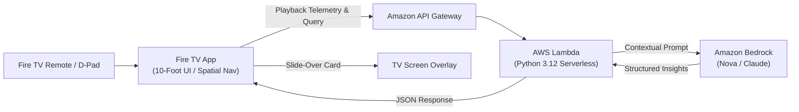

# CineLens AI 🎬✨
### Intelligent Multi-Modal Viewing Companion for Fire TV & Vega OS
> **Hackathon Submission**: Fire TV Track (Primary) • AWS Builder & Open Source (Mini Challenges)

[](LICENSE)
[](#)
[](#)

---

## 💡 Overview

**CineLens AI** reimagines the living room viewing experience. Taking the concept of Prime Video's iconic X-Ray to the generative AI era, CineLens AI acts as a contextual, real-time conversational companion built specifically for **Fire OS** and **Vega OS**.

Whenever a viewer pauses a movie or activates the remote trigger, CineLens surfaces:
- **🔍 Scene Explanation & Context**: Explains critical plot stakes, subtleties, and background details without spoiling future events.
- **🎭 Character & Actor Inspector**: Instantly identifies actors on screen, their character backstory, and past filmography.
- **⏪ 10-Minute Spoiler-Free Catch-Up**: Quick synopsis of recent minutes if you walked away from the couch or missed dialogue.
- **💬 Dialogue & Cultural Subtext**: Decodes whispered lines, idioms, and plot implications.
- **🎵 Soundtrack & Acoustic Telemetry**: Details the musical score and emotional resonance.
- **🎙️ Remote-Driven Voice & D-Pad Navigation**: 100% native 10-foot UI spatial navigation.

---

## 🏗️ Architecture



---

## 🎮 Fire TV Remote Control Mapping

CineLens AI is built from the ground up for a 10-foot living room experience using standard Fire TV remote keycodes:

| Remote Button | Key Code / Input | Action in CineLens AI |
| :--- | :--- | :--- |
| **D-Pad Up / Down** | `ArrowUp` (38) / `ArrowDown` (40) | Navigate vertically between controls & cards |
| **D-Pad Left / Right** | `ArrowLeft` (37) / `ArrowRight` (39) | Cycle between AI inquiry chips and timeline |
| **Select / OK** | `Enter` (13) | Execute query / Toggle play & pause |
| **Back Button** | `Escape` / `Backspace` (8) / `10009` | Dismiss CineLens drawer & resume playback |
| **Play / Pause** | `MediaPlayPause` (179) | Pause video & open CineLens AI buffer |
| **Menu Button** | `Menu` | Quick toggle CineLens overlay |

*(Note: The app includes an on-screen **Virtual Fire TV Remote HUD** in the bottom-right corner for quick testing directly in any desktop browser or video recording).*

---

## 🚀 Quickstart & Local Demo

### Prerequisites
- Python 3.10+ (installed)

### 1-Click Launch
Run the automated runner from the project root:
```bash
python run_demo.py
```
This automatically:
1. Starts the Fire TV Web App static server at `http://localhost:5500`.
2. Starts the local API server at `http://localhost:8000`.
3. Opens the interactive 10-foot TV interface in your browser.

---

## 📺 Deploying to Fire TV / Vega OS

### Method 1: Amazon Web App Tester (Fastest)
1. Install **Amazon Web App Tester** from the Amazon Appstore on your Fire TV device.
2. Ensure your Fire TV and computer are on the same Wi-Fi network.
3. Open Web App Tester on your TV, click **Add App**, and enter:
   - **App Name**: CineLens AI
   - **URL**: `http://<YOUR_COMPUTER_IP>:5500/index.html`
4. Launch and test using your physical Fire TV remote.

### Method 2: Sideloading / ADB Wrapper
1. Enable **Developer Options** and **ADB Debugging** on your Fire TV (`Settings > My Fire TV > Developer Options`).
2. Wrap using Capacitor/Cordova or package via Amazon Developer Console.

---

## ☁️ AWS Builder Mini-Challenge (Serverless Deployment)

Deploy the backend to AWS using AWS SAM:

```bash
cd backend
sam build
sam deploy --guided
```

This provisions:
- **Amazon API Gateway**: REST endpoint with CORS support.
- **AWS Lambda**: Python 3.12 function with IAM role permissions for `bedrock:InvokeModel` and `bedrock:Converse`.
- **Amazon Bedrock**: Foundation model integration (`amazon.nova-lite-v1:0` or Anthropic Claude).

---

## 👥 Hackathon Collaborators

For private GitHub repository review, the following Amazon team members have been added:
- `chris-trag`
- `knmeiss`
- `giolaq`
- `anishamalde`
- `mosesroth`
- `emersonsklar`
- `testing@devpost.com`
